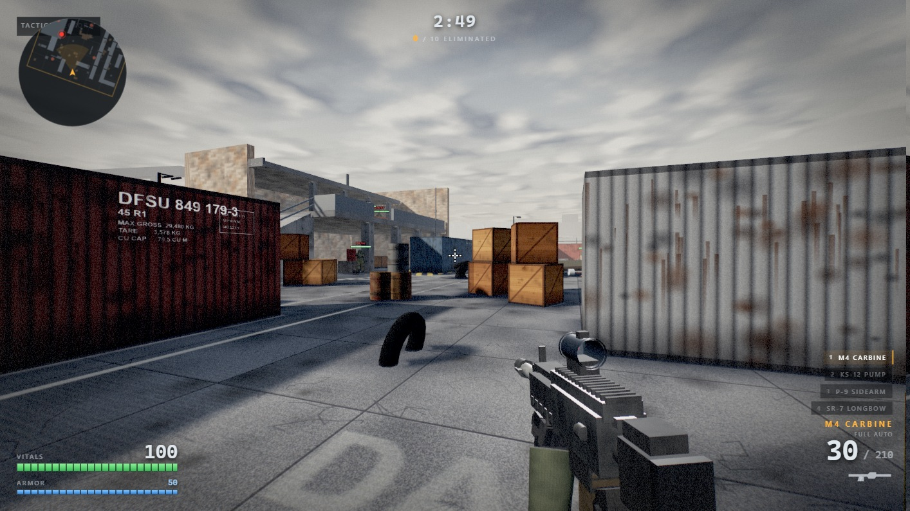
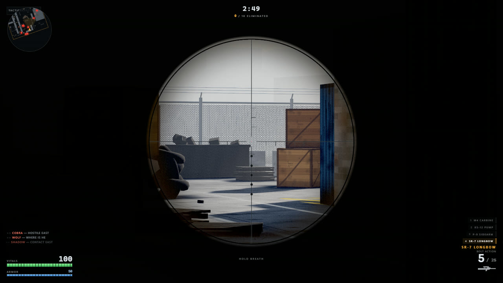
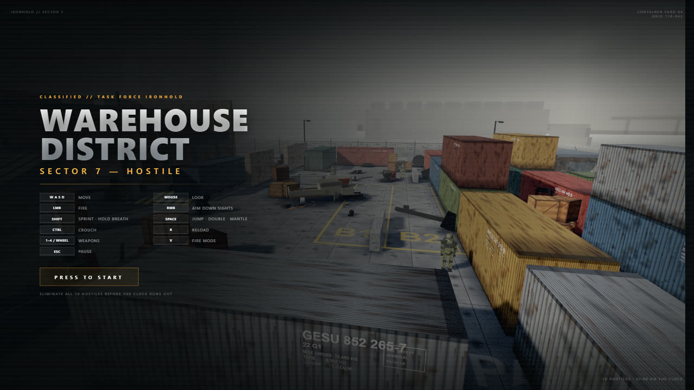

# Operation Ironhold 铁幕行动

> **本仓库是 [operation-ironhold](https://github.com/starknightt/operation-ironhold) 的中文翻译版本，面向中文用户。**
>
> 原项目由 Prasenjit（[@Star_Knight12](https://github.com/Star_Knight12)）创作，以 MIT 许可发布。
> 本次改动只涉及文本：界面文案、文档、代码注释与面向用户的提示信息全部译为中文，
> 代码逻辑、数值、标识符、命令、路径、URL 与配置键保持不变。
> 汉化后的分支**后续由本仓库维护者独立开发**，与上游不再保持同步；上游更新不会自动合入。

一个完整的第一人称射击游戏，跑在浏览器标签页里。只有一个 HTML 文件，
没有构建步骤，不需要包管理器，磁盘上也没有任何图片、音频或模型文件。

**[在线试玩（中文版）](https://ironhold-zh.app.workbuddy.host/?sharecode=UDGPWQZB3V)**
　|　[在线试玩（原版，英文）](https://starknightt.github.io/operation-ironhold/)



十名敌人据守着第 7 区的一处集装箱场，你有三分钟清场。

整个游戏——渲染器装配、世界生成、武器操作、敌人 AI、音频合成、后处理与 HUD——
大约 6 500 行 JavaScript 与 CSS，全部内联在单个 290 KB 的 `index.html` 里。
唯一的外部资源是从 CDN 取用的 three.js r128，其余一切都在运行时生成。

它是由一个 AI 智能体依据五条提示词构建出来的，这些提示词逐字记录在
[PROMPTS.md](PROMPTS.md)（中文译文）。

## 运行

用任意桌面浏览器打开 `index.html`，安装过程就到这里。

如果你更想用本地服务器：

```bash
python -m http.server 8123
```

然后访问 `http://127.0.0.1:8123/index.html`。

点击页面即可开始。这次点击就是获取指针锁定的动作，所以在你的要求之前，
游戏无法捕获鼠标。按 `Esc` 释放指针并暂停，再点击遮罩继续。

需要支持 WebGL 与 Pointer Lock 的桌面浏览器。没有触屏输入，所以手机上玩不了。

## 操作

| 输入 | 动作 |
| --- | --- |
| `W` `A` `S` `D` | 移动 |
| 鼠标 | 视角 |
| 左键 | 开火 |
| 右键 | 切换开镜瞄准 |
| `R` | 换弹 |
| `Shift` | 冲刺；开镜时屏息 |
| `Ctrl` | 蹲伏 |
| `Space` | 跳跃；空中再点一次二段跳；在边缘附近按住翻越 |
| `1` `2` `3` `4` | M4 卡宾枪 / KS-12 泵动霰弹枪 / P-9 手枪 / SR-7 长弓 |
| `V` | 步枪在全自动与半自动之间切换 |
| 鼠标滚轮 | 循环切换武器 |
| `Esc` | 暂停 |

## 回合

在 3:00 内消灭全部十名敌人。开局 100 生命、50 护甲，护甲在耗尽前吸收一半伤害。

开局前三秒敌人不开火，让你先定神；而且战斗调度器会把同时在向你射击的人数
限制在两个。其余的人继续机动。正是这一条限制，让交火保持可读，
而不是塌成一片你无法回应的交叉火力。

阵亡或倒计时结束即告回合结束。战报界面显示击杀数、爆头数、命中率与存活时间。

## 武器

| 槽位 | 武器 | 弹匣 | 备弹 | 特性 |
| --- | --- | --- | --- | --- |
| 1 | M4 卡宾枪 | 30 | 210 | 760 发/分全自动，`V` 切半自动 |
| 2 | KS-12 泵动霰弹枪 | 8 | 48 | 每发九颗弹丸，两发之间泵动 |
| 3 | P-9 手枪 | 15 | 90 | 430 发/分半自动，出枪最快 |
| 4 | SR-7 长弓 | 5 | 25 | 栓动，打中躯干即致命 |

每把武器都有一具由基本几何体搭成的手持模型，配戴手套的双手，随鼠标移动摇摆，
随脚步上下晃动，换弹时滑出画面，并抛出在混凝土上弹跳的黄铜弹壳。
枪口焰是一张精灵贴图，背后配一盏真实的点光源，由泛光通道拾取。
步枪沿固定的后坐图案上抬而不是随机散布，所以你能学会如何压枪。

## 瞄准



右键切换开镜。每把武器都需要整整 0.2s 稳定进出，期间散布收紧，
持镜时移动速度扣减 40%。

| 武器 | 视场角 | 放大 | 瞄具 |
| --- | --- | --- | --- |
| M4 卡宾枪 | 75 → 38 | 2.2x | 着色镜片上的红点 |
| KS-12 泵动霰弹枪 | 75 → 60 | 1.3x | 高出隔热罩的珠形准星 |
| P-9 手枪 | 75 → 50 | 1.7x | 三点式机械瞄具，开放式缺口 |
| SR-7 长弓 | 75 → 15 | 5.8x | 镜片叠层，密位点分划 |

真正改变屏幕的是狙击枪。开镜会把准星换成整块镜片叠层，并把武器藏到镜片之后，
合成着色器再用真实光学镜片的方式给它蒙上一层。视野在两条慢正弦上漂移；
按住 `Shift` 可稳定三秒，之后必须松手重新换气。鼠标灵敏度随倍率缩放，
所以屏幕上的瞄准手感保持一致。枪机需要 1.5s 动作，这让一次失误变得相当昂贵。

## 移动

集装箱顶、木箱、油桶堆、烧毁的平板车以及其他所有实体道具都可以走上去。
一次跳跃约越过 1.2m，二段跳再加 0.9m。在空中按住 `Space`、靠近脚上方约 1.95m
以内的边缘，会被拉上去——这正是让你从平地上到集装箱顶、
并且不用坡道就登上狙击平台的方式。

## 敌人

十名士兵沿路径点巡逻，使用位于玩家同样遵守的碰撞体之上的网格寻路绕开掩体。
发现你需要 300 到 800ms 的人类反应时间，发现时他们会通过无线电报告。

交战中他们会奔向掩体、侧移、包抄、换弹；即使隔着掩体能看到你，
只要枪口被挡住就不会开火。视线判定从玩家一端与敌人一端同时投射，
保证两边一致：你打不到他，他也打不到你。爆头造成双倍伤害，命中会产生晃动，
死亡则是一段布娃娃式倒地，武器脱手掉落。

## 一切都在运行时生成

本仓库里没有任何图片、音频或模型文件。

混凝土、瓦楞钢板、胶合板、锈迹、砖墙与铁丝网都在加载时画进 canvas，
连集装箱侧面的喷印标识也不例外。武器、双手与士兵由盒子、圆柱和球体拼装而成。
天空逐片元求值，地平线上的工业天际线是几何体。

每一个声音都由 Web Audio API 合成：每把武器的枪声由爆裂、主体与胸腔冲击分层叠加，
换弹、脚步、墙面与肉体不同的命中声、低血量心跳，以及一段环境工业嗡鸣——
远处金属的吱嘎声按随机间隔出现。还有一个用生成的脉冲响应构建的卷积混响。



## 性能

动态分辨率缩放监视帧时间，并调整渲染比例以维持目标帧率。
重复道具按颜色分组的 `InstancedMesh` 绘制。静态景物合并成单次绘制调用。
曳光弹、贴花、弹壳与粒子都做了池化。投影按包围盒尺寸裁剪，
为那些只贡献一个亚像素污点的物体砍掉了大约三分之二的阴影阶段。

## 实现要点

在改动 `index.html` 之前，有六件事值得了解。

**没有环境贴图。** three.js 渲染金属时若没有东西可反射，结果近乎纯黑，
所以所有材质的 `metalness` 都保持在接近非金属的区间（约 0.2 以下），
改用颜色和粗糙度伪造金属感。把集装箱或武器的 `metalness` 调高，
任何背向太阳的面都会塌成黑色。

**色彩空间是手动处理的。** 渲染器保持线性输出，由合成着色器自己做 gamma 编码，
所以材质颜色在启动时由 `linearizeMats()` 统一过一遍 `convertSRGBToLinear()`。
新增材质需要同样处理，否则会显得过饱和。

**后处理是手写的。** r128 的 CDN 构建没有 `EffectComposer`，
所以泛光、色差、暗角、调色、受伤染色与低血量脉冲全部活在一趟合成通道里，
跑在一对渲染目标上。那里的阴影染色故意用乘法；在线性空间里做加法提亮
会淹没近黑像素，把整个画面推成蓝色。

**天空必须是着色器。** 它最初是一张 4096×2048 的等距圆柱画布，
听起来很够用，直到你算一下：4096 texel 摊在 360 度上，每度 11 texel，
而狙击镜 15 度的视野会把它铺到 1920 像素的屏幕上——约 170 个 texel，
也就是每个 texel 对应 11 个屏幕像素。把贴图加一倍只换来一档精度、却要 64MB，
而且解决不了另一半问题：等距圆柱投影会把每一列压到天顶，
画在那里的东西被拉成风车。替代方案改为逐片元求值渐变、云层与卷云，
镜片放大的是射线方向而不是位图。云层投影到头顶的一块平板上（`dir.xz / dir.y`），
于是它们朝地平线聚拢——这正是透视该有的样子——天顶只是平面的一个普通点，
而不是奇点。fbm 相对该投影的 `fwidth` 做了带限：比片元足迹更细的倍频被丢弃而不是采样，
这正是云层不会在地平线附近闪烁撕裂的原因——那里的平板把一度天空拉到几百个噪声格子上。
它的开销与纯色天空相当，因为穹顶在不透明队列里最后绘制，
早深度测试会杀掉每一片被墙挡住的天空。

**瞄具对齐是数据，不是猜。** 每把手持模型返回一个 `adsPos`，
把它的瞄具放到手持模型相机的 -Z 轴上：`x` 为零，`y` 是模型空间中瞄具高度的负值。
挪动瞄具，这个数字必须跟着动。需要*透视过去*的光学件要用开口几何体加双面材质，
因为封口的圆柱会渲染成一个实心圆盘。

**手持模型故意用长焦。** `VM_FOV` 是 41.9，而世界是 75，
每把武器都按比例放得更远以保持其屏幕尺寸。这两个数字是一对：
只收窄镜头不把枪推远，枪会变小；只把枪推远不收窄镜头，枪会变得极小。
这个配对换来的是更平缓的深度梯度，枪托不再在机匣上膨胀。
`adsRef` 是瞄具到眼睛的距离，驱动开镜推轨，所以它随 `adsPos.z` 缩放；
`adsPos.x` 与 `.y` 不随，因为瞄具对齐与距离无关。

还有两个小约定：可站立表面是「默认开、可关」的——`box()` 会把任何实体推入
`groundMesh`，而 `groundAt()` 只考虑探测高度及以下的表面；不过这只是默认值，
显式的 ground 标记必须能压过它——二层楼板故意设成 `collide:false`，
因为它是地板而不是墙。另外，准星画在 canvas 上而不是用 HTML 元素拼出来，
因为在 2px 粗细下每条边都必须落在完整设备像素上，否则就会糊。

## 仓库结构

```
index.html              整个游戏
PROMPTS.md              指定它的提示词（中文译文）
screenshots/            本 README 使用的图片
tools/test-harness.js   碰撞、武器与 AI 测试套件
tools/autoplay-bot.js   用于无人值守回归的寻路机器人
```

`tools/` 里的两个文件仅供开发使用，`index.html` 都不引用它们；
它们被粘贴进控制台，或通过 DevTools 协议注入。测试装置提供碰撞审计、
武器精度与命中保真测试、地图边界探测以及敌人看门狗。
机器人能自行打完整回合，可配置瞄准误差与反应延迟，碰撞与 AI 的修复正是这样回归验证的。

## 许可

MIT，见 [LICENSE](LICENSE)。
许可证原文保持英文未作改动（法律文本不宜翻译），其余文档均为中文。

## 翻译说明

### 处理范围

- `index.html`：全部界面文案（开始界面、HUD、战报、暂停、加载与错误提示）、
  游戏内无线电喊话、敌人代号、地面与墙面喷绘标识，以及全部 624 处代码注释。
  未改动任何逻辑、数值、标识符、CSS 类名、ID、函数名与 URL。
- `PROMPTS.md`、`README.md`：全文中文。
- `tools/`：三个脚本的注释与开发者提示信息。
- `.gitignore`：注释中文。

### 术语对照

| 英文 | 中文 | 英文 | 中文 |
| --- | --- | --- | --- |
| aim down sights (ADS) | 开镜瞄准 | hip-fire | 腰射 |
| crosshair | 准星 | reticle | 分划 |
| viewmodel | 手持模型 | muzzle flash | 枪口焰 |
| recoil | 后坐 | spread | 散布 |
| magazine / reserve | 弹匣 / 备弹 | reload | 换弹 |
| killfeed | 击杀播报 | hitbox | 受击盒 |
| nameplate | 名牌 | line of sight (LOS) | 视线 |
| collider / AABB | 碰撞体 / 轴对齐包围盒 | raycast | 射线检测 |
| waypoint / pathfinding | 路径点 / 寻路 | cover | 掩体 |
| combat director | 战斗调度器 | burst | 点射 |
| draw call | 绘制调用 | render target | 渲染目标 |
| dynamic resolution | 动态分辨率 | post-processing | 后处理 |
| bloom | 泛光 | vignette | 暗角 |
| albedo | 反照率（基础色） | roughness / metalness | 粗糙度 / 金属度 |
| mil-dot | 密位点 | field of view (FOV) | 视场角 |

### 刻意保留英文的部分

- 专有名词与型号：`OPERATION IRONHOLD`、`IRONHOLD`、`M4`、`KS-12`、`P-9`、`SR-7`、
  `CSC`、`M-LOK`、`three.js` 及其 API 名。
- 集装箱标准铭文：`MAX GROSS`、`TARE`、`CU CAP`、`CSC SAFETY` —— 真实集装箱即如此标注。
- 代码标识符、CSS 类名、元素 ID、配置键、命令行、URL、许可证原文。

### 待确认项

1. ~~`canonical`、`og:url`、`og:image` 仍指向上游 Pages 地址~~ —— **已处理**：已改为当前线上地址
   `https://ironhold-zh.app.workbuddy.host/`。若日后更换部署域名，需同步替换 `index.html` 头部
   这 5 处（第 10、14、17、18、29 行）。
2. `og.jpg` 与 `screenshots/*.jpg` 仍是英文界面截图，未重制。
3. `PROMPTS.md` 中的提示词已译为中文，因此不再是「逐字记录」；英文原文见上游仓库。
4. 敌人代号（VIPER/COBRA 等）已本地化为中文代号，如需保留英文可回退。
5. 仓库简介（GitHub 右上角 Description）与仓库名未改，需在仓库设置里手动编辑。
6. 当前线上地址需携带 `?sharecode=` 参数才能访问（直接访问裸域名返回 403），
   因此 `canonical` 与 `og:*` 里都保留了这个参数；换绑自定义域名后可去掉。
